# Frictionless Notes

**A personal productivity app for capturing notes, organising checklists and managing everyday tasks.**

Frictionless Notes is a mobile productivity app built with React Native, Expo and TypeScript. It is designed around a simple idea: everyday note-taking and task management should feel effortless. Create a note, organise a shopping list, check something off, and get on with your day.

---

## The need

We use notes apps for some of the simplest things in everyday life: writing down groceries, keeping track of tasks, saving ideas, or organizing our thoughts.

Yet something as simple as managing a shopping list can become unnecessarily frustrating. Small interactions, unexpected keyboard pop-ups, accidental edits, and having to be precise about where you tap can turn a quick task into an annoying experience.

I wanted something simpler.

## The problem

Most notes apps offer an incredible amount of functionality, but sometimes that comes at the cost of simplicity.

I found myself spending more time interacting with the app than actually using it. Something as straightforward as checking an item off a shopping list shouldn't require opening an editor, accidentally triggering the keyboard, or carefully tapping a tiny checkbox.

The experience should feel natural. You should be able to open a note, interact with it, and get on with your day.

## A different approach

Frictionless Notes is built around one simple idea:

> **The app should adapt to the way you use notes, not make you adapt to the app.**

Instead of prioritizing endless features, I wanted to focus on the small interactions that make an everyday difference.

- Tap anywhere on a checklist item to mark it as completed.
- Keep viewing and interacting with your lists without accidentally entering edit mode.
- Create and manage notes without unnecessary steps: double-tap **+** for an instant note, and undo a delete instead of confirming it.
- Keep navigation under your thumb, in one bottom bar.
- Work offline, with your notes stored locally on your device.
- Keep the interface clean, intuitive, and focused on the content.

The goal isn't to compete by having the most features. It's to make the basic experience feel better.

## The personal experience behind it

Frictionless Notes started from my own frustration with existing note-taking apps, particularly when managing shopping lists.

I was using Samsung Notes and found myself repeatedly running into small usability issues. Gboard appearing when I didn't need it, accidentally entering editing mode, and the simple act of checking off an item feeling less intuitive than it should.

These weren't major problems individually, but they kept interrupting something that should have been effortless.

I started thinking: what if I built a notes app that removed those little frustrations?

That thought eventually became Frictionless Notes.

What started as a personal solution turned into a project where I could explore mobile development, user experience, interaction design, and the process of building a complete application from an idea.

It's not about reinventing note-taking. It's about paying attention to the details that make everyday software enjoyable to use.

---

## Features

- **Quick notes** — capture and edit everyday notes.
- **Checklists and shopping lists** — add, check off, edit and reorder items; see progress at a glance, uncheck everything for the next shop, or clear what is done.
- **Custom Notes** — rich-text editing with fonts, sizes, bold, italic, underline, strikethrough, text and highlight colours, headings, quotes, lists, dividers, alignment and paragraph spacing, plus one-tap *Clear formatting*.
- **Embedded checklists** — combine checklist blocks with regular text in one note.
- **Page style** — ready-made page themes (Notebook, Journal, Blueprint, Night and more), ten page colours or your own, ruled, dotted and grid paper, page font, text size, line spacing and margins. Text always stays readable, on dark pages in the light theme and on pale pages in the dark theme.
- **Templates** — Plan, Journal, Meeting notes, Weekly plan and Recipe.
- **Inline images** — add local photos to Custom Notes, then move, resize, replace or remove them.
- **Find things fast** — search, filter by Notes, Lists, Pinned, Reminders or Locked, and sort by last edited, date created or title.
- **Pin, duplicate and share** — every note has one menu (tap ⋯ or hold the note) for pinning, locking, sharing as text, duplicating and moving to Trash.
- **Local reminders** — schedule reminders using the device's time zone, with a configurable “After work” time.
- **Trash and recovery** — deleting is instant with an Undo; notes stay recoverable for 30 days.
- **Privacy** — optional App lock and per-note locks that use the phone's fingerprint, face or PIN, and an option to block screenshots and hide notes in the recent-apps view.
- **Light, dark or system theme** — a flat, quiet interface with one accent colour.
- **On-device storage** — notes are stored with SQLite; note images are kept in the app's documents directory.

## Screenshots

These images come from a preview build with sample notes. Retake them on a device before using them in a store listing.

### Light theme

<table>
  <tr>
    <td align="center" width="33%">
      <strong>Home</strong><br>
      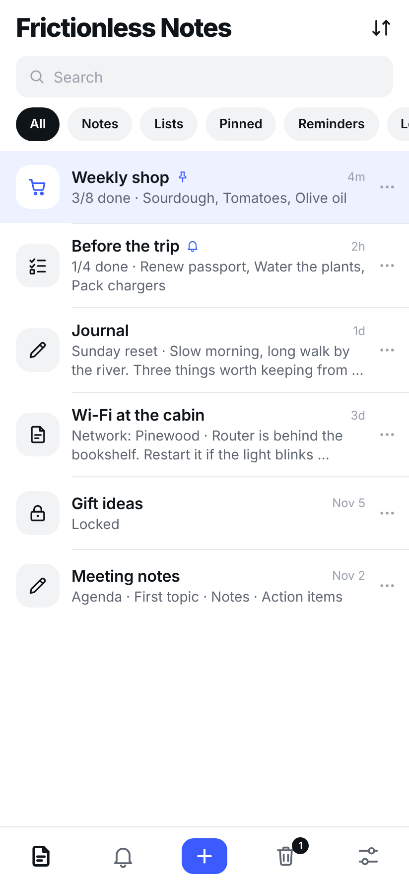
    </td>
    <td align="center" width="33%">
      <strong>Shopping list</strong><br>
      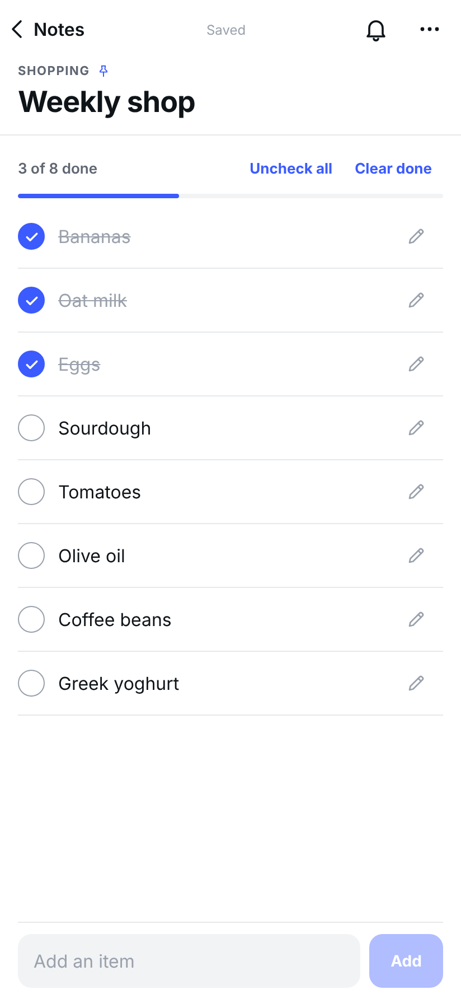
    </td>
    <td align="center" width="33%">
      <strong>Custom Note</strong><br>
      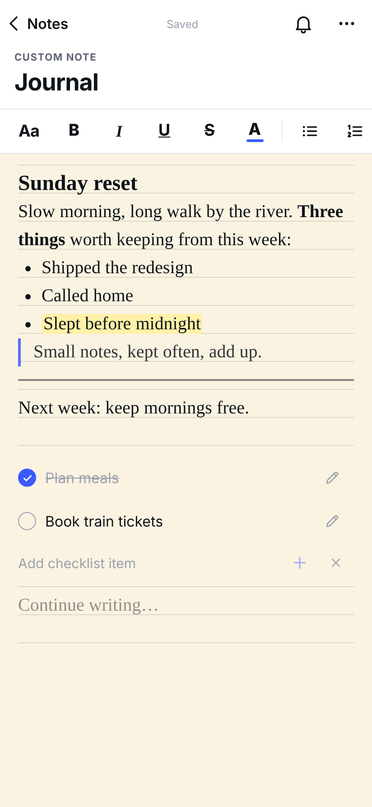
    </td>
  </tr>
  <tr>
    <td align="center">
      <strong>Page style</strong><br>
      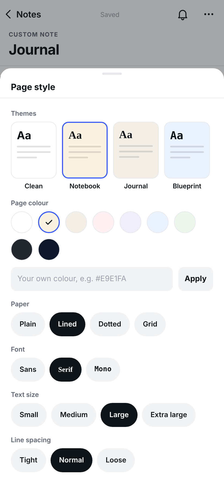
    </td>
    <td align="center">
      <strong>Night page</strong><br>
      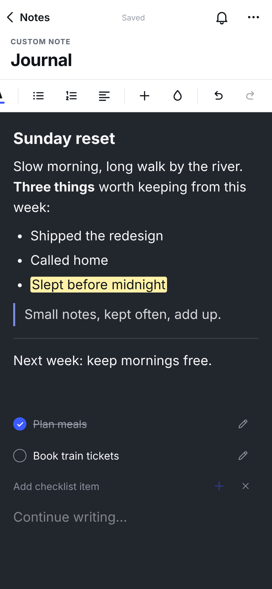
    </td>
    <td align="center">
      <strong>Reminders</strong><br>
      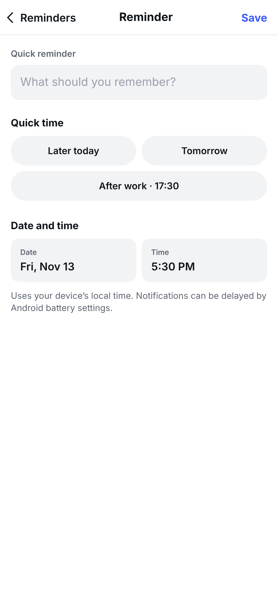
    </td>
  </tr>
  <tr>
    <td align="center" colspan="3">
      <strong>Settings</strong><br>
      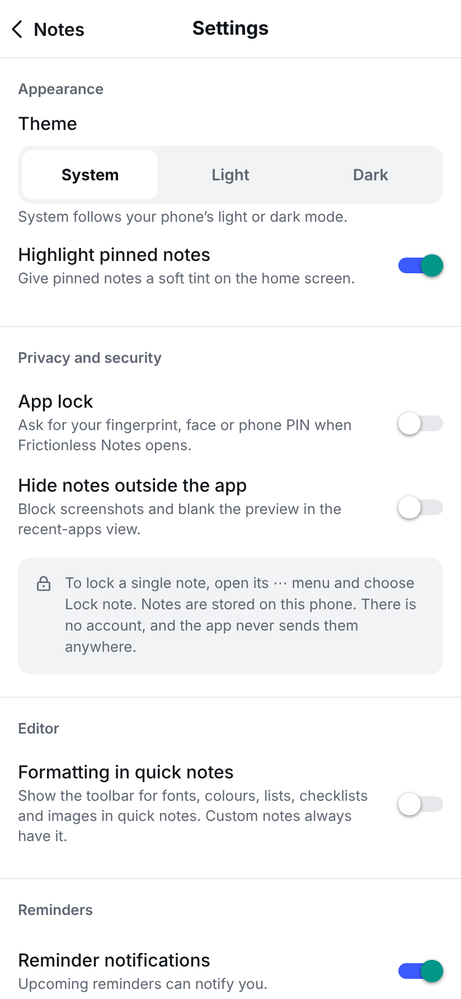
    </td>
  </tr>
</table>

### Dark theme

<table>
  <tr>
    <td align="center" width="33%">
      <strong>Home</strong><br>
      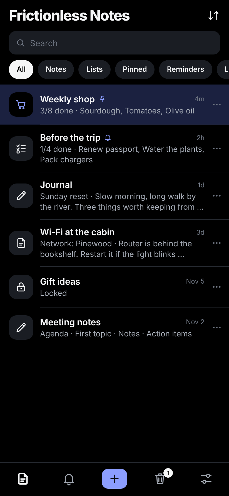
    </td>
    <td align="center" width="33%">
      <strong>New note menu</strong><br>
      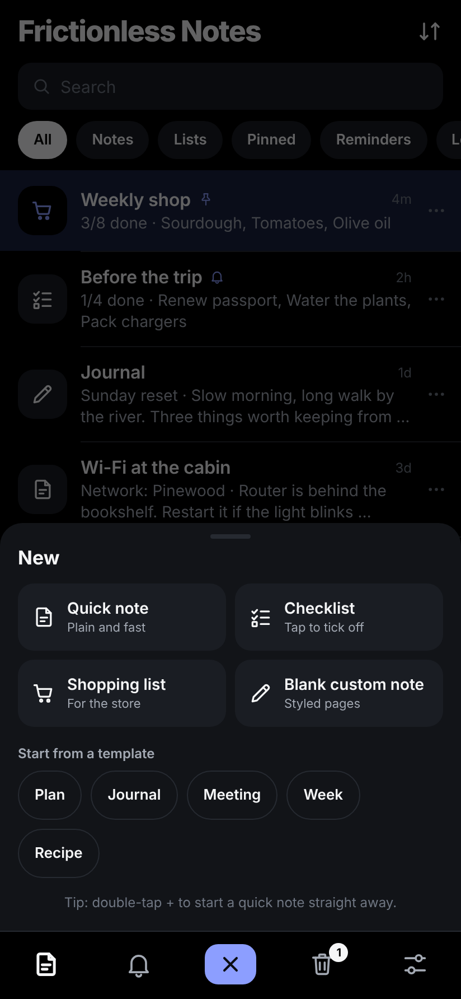
    </td>
    <td align="center" width="33%">
      <strong>Shopping list</strong><br>
      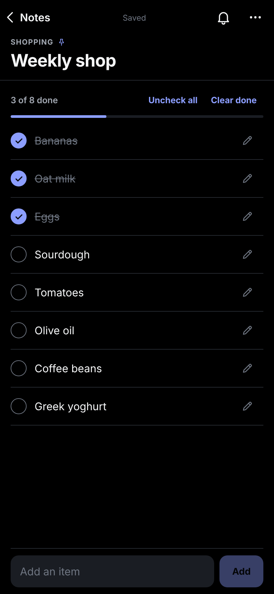
    </td>
  </tr>
  <tr>
    <td align="center" colspan="3">
      <strong>Settings</strong><br>
      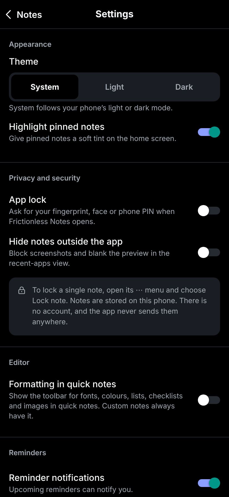
    </td>
  </tr>
</table>

---

## Tech stack

| Area | Technology |
| --- | --- |
| Mobile framework | React Native 0.88.1 |
| App platform/tooling | Expo SDK 58 |
| Language | TypeScript 7 |
| UI | React 19 |
| Icons | Hand-drawn outline set on `react-native-svg` |
| Local database | `expo-sqlite` |
| Reminders | `expo-notifications` |
| Image selection | `expo-image-picker` |
| App lock and locked notes | `expo-local-authentication` |
| Screenshot blocking | `expo-screen-capture` |
| System theme | `expo-system-ui` |
| Rich-text editor | TenTap / Tiptap |
| Gestures and animation | React Native Gesture Handler, Reanimated, Draggable FlatList |
| Editor bundle | Vite 8 |

## Getting started

### Requirements

- Node.js **22.13 or newer** (the EAS build profiles use Node.js 22.23.3)
- npm
- Android Studio and Android SDK for local Android builds
- An Android device with USB debugging enabled, or an Android emulator

The complete Custom Note editor uses TenTap's advanced editor setup and a development build. Expo Go does not provide the complete native app setup.

### Install dependencies

Clone the repository and install its dependencies:

```bash
git clone https://github.com/SarunasSimanaitis/frictionless-notes.git
cd frictionless-notes
npm install
```

The `postinstall` script applies a version-checked compatibility patch for `react-native-draggable-flatlist` and builds the custom TenTap editor bundle.

### Run the Android development build

Build and install the development client:

```bash
npm run android:fresh
```

This regenerates the native Android project from `app.json` (app name, icon, permissions and native modules) and installs the app. Use it the first time and whenever a dependency or `app.json` changes; plain `npx expo run:android` is enough in between.

### Try a branch next to the installed app

To compare a branch with the version already on your phone without replacing it:

```bash
npm run android:compare
```

This installs a second app, labelled “Frictionless Notes (new)”, with its own package name and its own empty set of notes. The app you already have, and its notes, are left untouched. For an installable APK instead, run `npx eas-cli build --platform android --profile compare`.

Run `npm run android:fresh` afterwards to go back to the normal package name.

Then start the development server:

```bash
npx expo start --dev-client
```

Open the installed development build on your device or emulator.

For iOS development, use a Mac with the required Xcode tooling:

```bash
npx expo run:ios
```

## Build an Android APK

An internal preview profile is configured in `eas.json` and produces an APK:

```bash
npx eas-cli login
npx eas-cli build --platform android --profile preview
```

A production EAS profile is also configured for a production Android app bundle. Review app signing, store metadata, privacy disclosures and release configuration before publishing to an app store.

## Useful scripts

| Command | Purpose |
| --- | --- |
| `npm start` | Start Expo |
| `npm run android` | Build and run the Android app locally |
| `npm run android:fresh` | Regenerate the native project, then build and run |
| `npm run android:compare` | Install a separate “(new)” copy next to the existing app |
| `npm run ios` | Build and run the iOS app locally |
| `npm run typecheck` | Run the TypeScript type check |
| `npm test` | Run the Node.js test suite |
| `npm run editor:build` | Build the custom TenTap editor bundle |
| `npx expo install --check` | Check package versions against the Expo SDK |
| `npx expo-doctor` | Check Expo project configuration and dependencies |

## Project structure

```text
.
├── App.tsx                    # App startup, state and navigation
├── assets/                    # App icon, logo and splash artwork
├── editor-web/                # Custom TenTap editor and Vite build
├── scripts/                   # Dependency compatibility patch and Android run helper
├── src/
│   ├── editor/                # Custom Note editor, formatting toolbar and page style
│   ├── lists/                 # Checklist components
│   ├── screens/               # Home and note editor screens
│   ├── security/              # Device-lock checks and the lock screen
│   ├── ui/                    # Icons, bottom sheet, toast and other shared pieces
│   ├── brand.ts               # The app's display name
│   ├── theme.ts               # Colours for the app and for note pages
│   ├── database.ts            # SQLite database and migrations
│   ├── model.ts               # Note models and domain operations
│   ├── notifications.ts       # Local reminder scheduling
│   └── noteImages.ts          # Local image storage
├── tests/                     # Model, theme and UI contract tests
├── app.json                   # Expo app configuration
├── app.config.cjs             # Optional "compare" build variant
├── eas.json                   # EAS build profiles
└── package.json
```

## Data and privacy

Frictionless Notes is designed to work without an account or remote backend.

- Notes, checklist items, preferences, reminder metadata and document content are stored locally on the device.
- Note images are copied into the app's local documents storage.
- The project does not implement accounts, cloud synchronization, collaboration or a remote backend, and the app makes no network requests of its own.
- **App lock** asks for the phone's fingerprint, face or PIN when the app opens and after it has been in the background for more than 20 seconds.
- **Locked notes** hide their preview, are left out of content search, and ask for the same device lock before opening.
- **Hide notes outside the app** blocks screenshots and blanks the app's preview in the recent-apps view.
- The app never sees or stores your fingerprint or PIN; Android or iOS does the check and reports only success or failure.

What the locks do not do: they do not add a second layer of encryption. Notes rely on the storage encryption the phone already provides, so the locks protect against someone holding your unlocked phone, not against someone with full access to the device's storage. Android's own device backup may also include app data, depending on the phone's backup settings.

Because data is stored locally, uninstalling the app or clearing its data can remove notes and images. Back up important information before removing the app or resetting device data.

## Verification

Run these checks before preparing a release:

```bash
npm run typecheck
npm test
npx expo install --check
npx expo-doctor
npx expo export --platform android --output-dir dist
```

Automated checks do not replace testing on a physical device. In particular, verify:

- App lock, locked notes and screenshot blocking
- Keyboard behavior and checklist interaction
- Checklist editing and reordering
- Reminder permissions and notification delivery
- Custom Note formatting
- Image placement and persistence
- Trash recovery
- Searching for and reopening notes

## Current limitations

- No account system, cloud backup or synchronization.
- Locks rely on the device's screen lock and do not encrypt notes separately.
- Duplicating a note does not copy its images.
- No shared notes or real-time collaboration.
- Reminder delivery depends on operating-system notification permissions and battery-management policies.
- Custom Notes use continuous scrolling; fixed-page pagination is not implemented.

## Roadmap

The project is evolving, but areas for future improvement include:

- More device-level testing and accessibility refinement.
- A straightforward backup and restore workflow.
- Further polish to editing, navigation and small interaction details.
- Release preparation and distribution.

## License

This project is released under the **0BSD** license. You may use, copy, modify and distribute the software for any purpose, with or without fee, subject to the terms in [LICENSE](./LICENSE). The license identifier in `package.json` is also set to `0BSD`.
